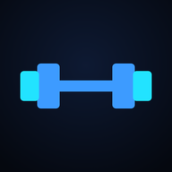
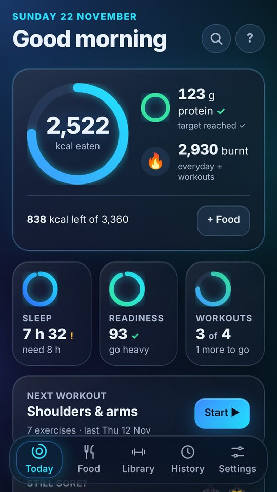
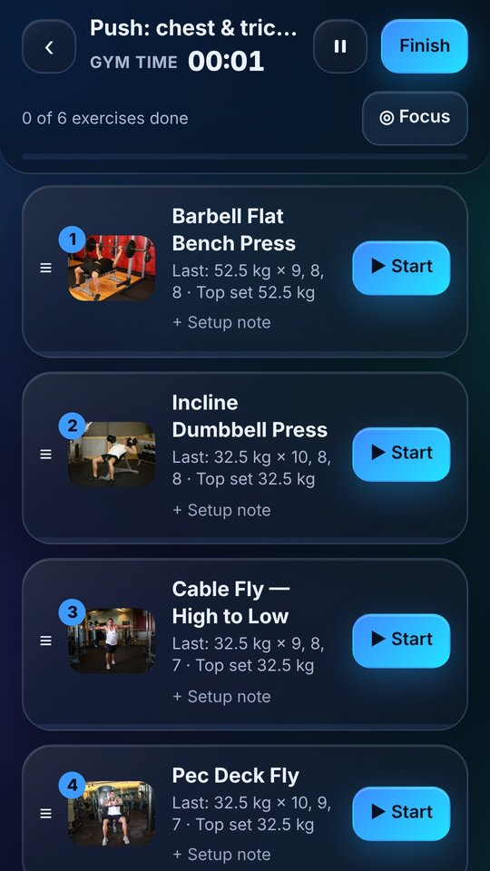
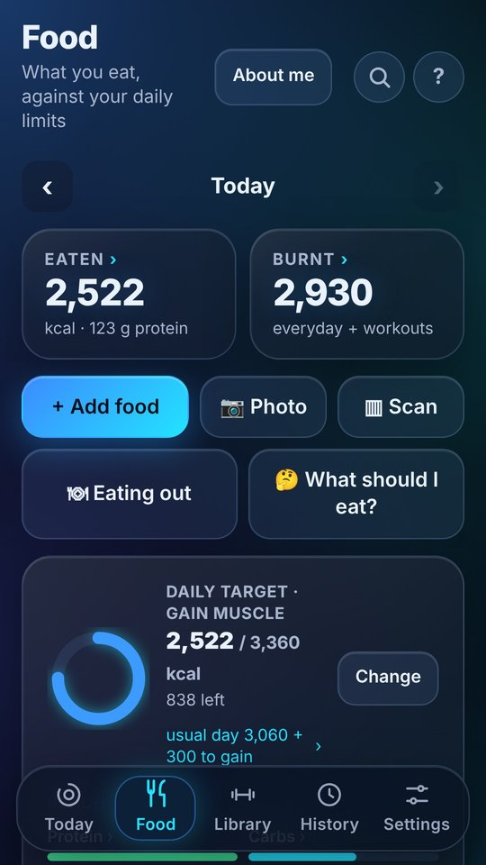
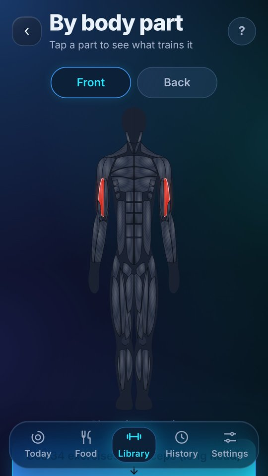

<p align="center">
  
</p>

<h1 align="center">GymDay: Workout &amp; Food Log</h1>

<p align="center">
  Your gym days, your food and your progress in one place, made for training in India.<br>
  Android and iPhone · free · no ads · works without an account
</p>

<p align="center">
  <a href="https://github.com/NoMercyNinja0/GymDay/actions/workflows/tests.yml"></a>
  <a href="https://github.com/NoMercyNinja0/GymDay/actions/workflows/ios.yml"></a>
  <a href="LICENSE"></a>
  
</p>

<p align="center">
  <b>Status:</b> the iPhone app is in App Store review, and the Android app is coming to Google Play.
</p>

<p align="center">
  
  
  
  
</p>

## What it does

**Workouts**
- Build your own days (Push, Pull, Legs…) from 220+ exercises with pictures and form cues.
- Log sets in a few taps: the next set is suggested from last time, warm-ups included.
- Gym time on the lock screen, with Tick set and Next buttons.
- Records, weekly sets per muscle, a body map of 43 muscle parts with soreness worked out after each workout, a plateau plan and your year in review.

**Food**
- Thousands of foods: home cooking, regional dishes, packets with their labels and big restaurant chains' menus.
- Snap a meal: the AI reads the photo, and you check each line before it is saved.
- Calories, protein, carbs, fat, fibre, vitamins and minerals against targets for your age and goal.
- Barcode scanning, supplement reminders, and Swiggy or Zomato order screenshots read for you.

**Your watch**
- Heart rate and calories for each workout, and steps, sleep and readiness each day, from Health Connect (Android) or Apple Health (iPhone), only when you turn it on.

**Clubs**
- Start a club or join one with a code: a weekly leaderboard, chat, cheers and challenges with friends. Report and Block are on every message and person.

**Private by default**
- Use it on the phone only with no account, or sign in with your email to keep a copy in your account.
- No ads. Nothing is sold.

## How it's built

GymDay is one web app (plain HTML, CSS and JavaScript, no framework) that runs inside a small native app on each phone.

| Part | Folder | Made with |
|---|---|---|
| The app itself | `android/app/src/main/assets/www` | HTML, CSS, JavaScript |
| Android app | `android/` | Java, WebView, Health Connect, widgets, Quick Settings tiles, a live workout notification |
| iPhone app | `ios/` | Swift, WKWebView, Apple Health, widgets, Live Activity, Control Center, Share extension |
| Server (optional) | `server/` | Supabase (Postgres with row-level security) and one Edge Function in TypeScript |
| AI photo reading | `server/functions/gd-meal-photo` | Anthropic's Claude API, called only from the server |

Everything is saved on the phone first. With an account, a copy is kept on the server and clubs work.

Every push is checked on GitHub: the Android app is built and its unit tests run, the server's tests run, the page's scripts are checked, and the iPhone app is built for the simulator.

## Folder layout

```
android/   Android app (Gradle). The web app lives in app/src/main/assets/www
ios/       iPhone app: Swift code, widgets, Share extension and the Xcode project
server/    Supabase setup SQL, the Edge Function and their tests
tools/     bundle.py (joins the scripts the way the Android build does) and shape.js (a check)
docs/      Pictures for this README
```

## Build the Android app

You need JDK 17 and the Android SDK with Android 16 (API 36). Android Studio has both. The app runs on Android 8.0 and newer.

```bash
cd android
./gradlew assembleDebug        # app/build/outputs/apk/debug/app-debug.apk
./gradlew testDebugUnitTest    # the Android tests (Robolectric)
```

Before every build, the `bundleWww` Gradle task joins the page's scripts into one file, `gymday.js`, so the phone loads one script instead of many.

**Release builds:** copy `android/keystore.properties.example` to `android/keystore.properties`, fill in your own key, then run `./gradlew assembleRelease bundleRelease`. Git ignores `keystore.properties` and key files: never commit them.

## Build the iPhone app

You need a Mac with Xcode. The app runs on iOS 18 and newer.

```bash
cd android && ./gradlew :app:bundleWww && cd ..   # makes android/app/build/www-bundle/www
python3 ios/tools/make_www.py                      # copies it to ios/www, with Android words changed to iPhone ones
open ios/GymDay.xcodeproj
```

Pick an iPhone simulator and press Run. To run on a real iPhone, use your own Apple developer team and app IDs:

```bash
GYMDAY_TEAM=YOUR_TEAM_ID GYMDAY_ID=com.yourname.gymday python3 ios/tools/gen_project.py
```

More in [ios/README.md](ios/README.md).

## Run your own server (optional)

GymDay works fully on the phone without a server. Accounts, clubs and AI photo reading need a [Supabase](https://supabase.com) project:

1. Create a Supabase project.
2. In its **SQL Editor**, run `server/gymday-supabase-setup.sql`. It is safe to run again.
3. GymDay signs in with a 6-digit code sent by email. In **Authentication → Email Templates**, make "Magic link or OTP" and "Confirm sign up" show the code with `{{ .Token }}`.
4. Create an Edge Function called `gd-meal-photo` with the code in `server/functions/gd-meal-photo/index.ts`. Add the secret `ANTHROPIC_API_KEY` under **Edge Functions → Secrets**. `GD_AI_MODEL` (optional) picks the model.
5. Point the app at your project: fill in `url` and `key` in `android/app/src/main/assets/www/config.js`, or in the app tap **Settings → Connect the GymDay server**. Use the project's **publishable** key, never the secret one.

Server tests (Node 22.6 or newer):

```bash
cd server
npm install
node test_sql.js && node test_sql18.js && node --experimental-strip-types test_fn.mjs
```

## Version history

GymDay went from its first build to the stores in eleven days. Every version is in [CHANGELOG.md](CHANGELOG.md).

## Contributing

Bug reports, ideas and small fixes are welcome. See [CONTRIBUTING.md](CONTRIBUTING.md). Security problems go by email: see [SECURITY.md](SECURITY.md).

## Privacy

Everything stays on the phone unless you sign in. Watch and health data is read only after you turn it on, and is never used for ads or sold. Read the [privacy policy](https://claude.ai/artifact/XrUPwNsM99sMBKQJ52obsr).

## Credits

Exercise photos come from the public-domain free-exercise-db project. Foods come from USDA FoodData Central, the Indian Nutrient Databank, ICMR-NIN's Indian Food Composition Tables 2017, the UK's CoFID, AUSNUT 2023, the FAO/INFOODS West Africa table, Open Food Facts (ODbL) and restaurant chains' published numbers. Icons come from Lucide (ISC). The full list, with each licence, is in [THIRD_PARTY.md](THIRD_PARTY.md).

## Licence

GymDay's code is under the [MIT Licence](LICENSE). The food data, exercise photos and icons keep their own licences: see [THIRD_PARTY.md](THIRD_PARTY.md).

The name "GymDay" and its icon are not covered by the MIT Licence. If you publish your own version, please give it a different name and icon.

## Author

Made by **Venu Anand A**, with help from Claude (Anthropic). Questions or ideas: open an issue, or write to gymday89@gmail.com.
